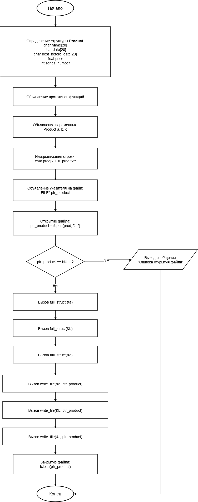
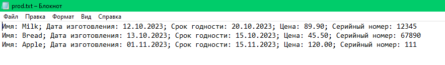

# Домашнее задание к работе 19

## Условие задачи
Разработайте программу, которая записывает в файл поля структуры задания 3 работы 18

## 1. Алгоритм и блок-схема

### Алгоритм
1. **Начало**

2. **Конец**

### Блок-схема
 

## 2. Реализация программы

```
#define _CRT_SECURE_NO_WARNINGS
#include <stdio.h>
#include <locale.h>

struct product {
	char name[20];
	char date[20];
	char best_before_date[20];
	float price;
	int series_number;
};

typedef struct product Product;

void full_struct(Product* a);
void write_file(Product* ptr_prod, FILE* ptr_product);

int main(void) {

	setlocale(LC_CTYPE, "RUS");

	Product a, b, c;

	char prod[20] = "prod.txt";

	FILE* ptr_product;

	if ((ptr_product = fopen(prod, "at")) == NULL) {

		printf("Ошибка открытия файла\n");

		return -1;
	}

	full_struct(&a);
	full_struct(&b);
	full_struct(&c);

	write_file(&a, ptr_product);
	write_file(&b, ptr_product);
	write_file(&c, ptr_product);

	fclose(ptr_product);

	return 0;
}

void full_struct(Product* a) {

	printf("Введите имя товара: ");
	scanf("%s", a->name);
	printf("\n");
	printf("Введите дату изготовления товара: ");
	scanf("%s", a->date);
	printf("\n");
	printf("Введите срок годности товара: ");
	scanf("%s", a->best_before_date);
	printf("\n");
	printf("Введите цену товара: ");
	scanf("%f", &a->price);
	printf("\n");
	printf("Введите серийный номер товара: ");
	scanf("%d", &a->series_number);
	printf("\n\n");
}

void write_file(Product* ptr_prod, FILE* ptr_product) {

	fprintf(ptr_product, "Имя: %s; Дата изготовления: %s; Срок годности: %s; Цена: %.2f; Серийный номер: %d\n", ptr_prod->name, ptr_prod->date, ptr_prod->best_before_date, ptr_prod->price, ptr_prod->series_number);
}
```

## 3. Результаты работы программы

```
Введите имя товара: Milk

Введите дату изготовления товара: 12.10.2023

Введите срок годности товара: 20.10.2023

Введите цену товара: 89.90

Введите серийный номер товара: 12345


Введите имя товара: Bread

Введите дату изготовления товара: 13.10.2023

Введите срок годности товара: 15.10.2023

Введите цену товара: 45.50

Введите серийный номер товара: 67890


Введите имя товара: Apple

Введите дату изготовления товара: 01.11.2023

Введите срок годности товара: 15.11.2023

Введите цену товара: 120.00

Введите серийный номер товара: 111
```
 

## 4. Информация о разработчике

Лупачев Сергей бТИИ-262
